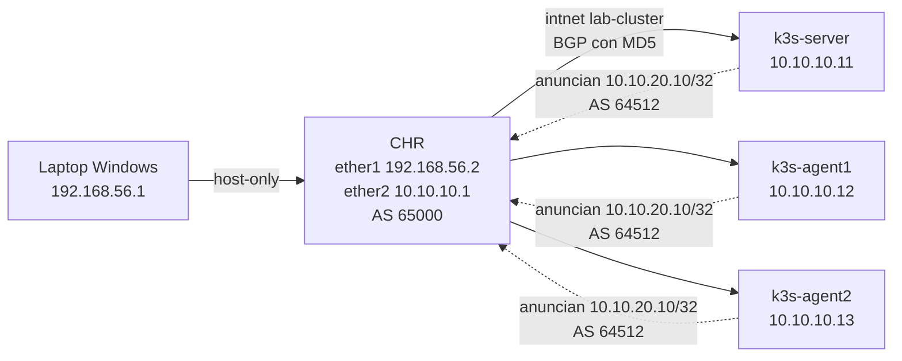

# Demo: servicios en alta disponibilidad con k3s

Un servicio web corre en un clúster k3s de 3 nodos y se publica por BGP hacia un router MikroTik CHR. Si se cae un nodo, el router deja de usarlo a los 9 s y el servicio sigue atendiendo. El tráfico entre namespaces está segmentado con NetworkPolicies y todo se ve en Grafana.

La demo corre en una sola PC, sin internet. Lo único que necesita internet es la instalación. Si es tu primera vez, empezá por [LEEME.md](../LEEME.md).

## Topología



Recorrido de un pedido: laptop → CHR (ruta /32 aprendida por BGP) → cualquier nodo → kube-proxy → pod `frontend` (namespace `web`) → `/api/` → pod `backend` (namespace `datos`). Cada VM tiene además una NIC en NAT, que usa Vagrant y que da internet para instalar.

| Qué | Valor |
|---|---|
| Laptop (host-only de VirtualBox) | 192.168.56.1 |
| CHR | 192.168.56.2 (ether1, clientes) · 10.10.10.1 (ether2, clúster) |
| k3s-server / agent1 / agent2 | 10.10.10.11 / .12 / .13 |
| Pool de servicios de MetalLB | 10.10.20.0/28; el frontend usa 10.10.20.10 |
| Grafana | http://10.10.10.11:30300 |
| ASN | CHR 65000 · clúster 64512 |

## Perfiles de RAM

| Perfil | Server | Agents | CHR | Cuándo |
|---|---|---|---|---|
| `chico` (por defecto) | 1,5 GB | 768 MB | 256 MB | Laptop de 8 GB |
| `normal` | 2 GB | 1 GB | 256 MB | Laptop de 16 GB, con `$env:PERFIL_RAM="normal"` |

## Puesta en marcha en Windows

Con Mac, los comandos que cambian están en [En Mac](#en-mac).

Requisitos: VirtualBox 7, Vagrant y 20 GB libres en el disco de las VMs. Con el laboratorio levantado no se usan WSL2 ni Docker Desktop; antes de empezar: `wsl --shutdown`. Las VMs de otras materias que usen 192.168.56.x tienen que estar apagadas.

Todos los comandos salen de la carpeta `demo`. Si Windows no deja correr los scripts: `powershell -ExecutionPolicy Bypass -File windows\<script>.ps1`.

1. Revisar la laptop y generar la clave SSH. Si C: no tiene lugar, sumar `-CarpetaVMs D:\VMs`.

   ```powershell
   windows\preparar-laptop.ps1
   ```

2. Levantar los 3 nodos.

   ```powershell
   vagrant up
   ```

3. Crear el CHR. En su consola: usuario `admin`, definir una clave y ver la IP de DHCP con `/ip address print`.

   ```powershell
   windows\crear-chr.ps1
   ```

4. Configurar el CHR con una copia temporal del `.rsc`. La sesión se corta al final del import y es lo esperado. Después, borrar el archivo del router porque tiene la clave BGP.

   ```powershell
   (Get-Content routeros\chr-borde.rsc) -replace 'CAMBIAR-CLAVE-BGP','<clave BGP>' | Set-Content -Encoding ascii $env:TEMP\chr-borde.rsc
   scp $env:TEMP\chr-borde.rsc admin@<IP de DHCP>:chr-borde.rsc
   ssh admin@<IP de DHCP> "/import file-name=chr-borde.rsc"
   ssh admin@192.168.56.2 "/file remove chr-borde.rsc"
   Remove-Item $env:TEMP\chr-borde.rsc
   ```

5. Agregar la ruta hacia el laboratorio, en una consola de administrador.

   ```powershell
   windows\rutas.ps1
   ```

6. Crear los secretos, con la misma clave BGP del paso 4.

   ```bash
   vagrant ssh k3s-server
   cd /vagrant/ansible/group_vars/all
   cp vault.example.yml vault.yml
   nano vault.yml
   (umask 077; read -rsp 'Clave del vault: ' c; echo; echo "$c" > ~/.vault_pass)
   ANSIBLE_CONFIG=/vagrant/ansible/ansible.cfg ansible-vault encrypt vault.yml
   ```

7. Instalar k3s dos veces (la segunda tiene que dar `changed=0`) y desplegar.

   ```bash
   /vagrant/ansible/run.sh site.yml
   /vagrant/ansible/run.sh site.yml
   /vagrant/ansible/run.sh deploy.yml
   ```

8. **Decisión de RAM.** Con todo levantado, Grafana abierto, Wireshark capturando y Claude abierto. Si el pico queda debajo del 85 %, se sigue con este perfil.

   ```powershell
   windows\medir-ram.ps1 -Minutos 10
   ```

9. Verificar.

   | Dónde | Qué | Esperado |
   |---|---|---|
   | CHR | `/routing bgp session print` | 3 sesiones establecidas |
   | CHR | `/ip route print where bgp` | 10.10.20.10/32 |
   | Navegador | http://10.10.20.10/ y http://10.10.20.10/api/ | Responden frontend y backend |
   | Navegador | http://10.10.10.11:30300 | Tablero del TP4 |
   | Server | `sudo /vagrant/scripts/prueba-netpol.sh` | 8 de 8 |

## Backups

`backup.yml` guarda dos cosas en `demo/backups/`, una carpeta compartida con el host: está fuera de git y sobrevive a un `vagrant destroy`.

| Archivo | Contenido | Protección |
|---|---|---|
| `chr-export-<fecha>.rsc` | Configuración del CHR | Se le quita la clave BGP antes de guardarlo |
| `k3s-<fecha>.tar.gz.enc` | Base de datos y token de k3s | Cifrado con la clave del vault |

Conserva los últimos 5 de cada uno. **Sin la clave del vault, el backup de k3s no se puede abrir**: guardala fuera de la VM.

No incluye las VMs ni las imágenes. Tampoco hace falta restaurar la aplicación desde el backup si se reconstruye todo, porque los manifiestos están en git.

Preparar el CHR, una sola vez, desde la carpeta `demo`. El usuario `backup` solo puede leer y entra con la clave del laboratorio; el firewall deja pasar SSH únicamente desde 10.10.10.11.

```bash
scp .claves/lab_ed25519.pub admin@192.168.56.2:lab_ed25519.pub
ssh admin@192.168.56.2 "/user add name=backup group=read password=<clave larga>"
ssh admin@192.168.56.2 "/user ssh-keys import user=backup public-key-file=lab_ed25519.pub"
```

Hacer un backup, en el server. El playbook revisa la integridad de la base y prueba abrir el paquete cifrado.

```bash
/vagrant/ansible/run.sh backup.yml
```

Probar la restauración: se hace un backup, se borra el frontend y se restaura. Mientras tanto, http://10.10.20.10/ deja de responder y después vuelve.

```bash
/vagrant/ansible/run.sh backup.yml
sudo k3s kubectl -n web delete deployment frontend
/vagrant/ansible/run.sh restore.yml -e confirmar=si
sudo k3s kubectl -n web rollout status deployment/frontend
```

`restore.yml` usa el backup más nuevo; para otro, sumá `-e archivo=k3s-<fecha>.tar.gz.enc`. La base anterior queda en `/var/lib/rancher/k3s/server/db.antes-<fecha>`. Vuelve atrás solo el clúster: las VMs tienen que existir y k3s tiene que estar instalado.

Para restaurar el CHR se vuelve a importar `routeros/chr-borde.rsc`, que es la fuente de verdad. La exportación sirve para ver si la configuración real se apartó de ese archivo.

## En Mac

Los pasos son los mismos y cambian estos comandos. Los scripts detectan si el Mac es Intel o Apple Silicon. Nunca se corrieron en un Mac real: anotá en `prueba-ram/RESULTADOS.md` lo que falle.

| Paso | Comando en Mac |
|---|---|
| 1. Revisar y generar la clave | `bash mac/preparar-mac.sh` (si hace falta, `--carpeta-vms /ruta`) |
| 2. Levantar los nodos | `vagrant up` |
| 3. Crear el CHR | `bash mac/crear-chr.sh` |
| 5. Agregar la ruta | `bash mac/rutas.sh`; hay que repetirlo después de cada reinicio |
| 6 y 7. Secretos y Ansible | Iguales: corren dentro de la VM server |
| 8. Medir la RAM | `bash mac/medir-ram.sh 10` |
| Guion: medir el corte | `sh scripts/medir-corte.sh http://10.10.20.10/ 200` |
| Guion: apagar y prender el agent | Los mismos comandos `VBoxManage` |

Paso 4, configurar el CHR:

```bash
sed 's/CAMBIAR-CLAVE-BGP/<clave BGP>/' routeros/chr-borde.rsc > /tmp/chr-borde.rsc
scp /tmp/chr-borde.rsc admin@<IP de DHCP>:chr-borde.rsc
ssh admin@<IP de DHCP> "/import file-name=chr-borde.rsc"
ssh admin@192.168.56.2 "/file remove chr-borde.rsc"
rm /tmp/chr-borde.rsc
```

| Mac | Qué tener en cuenta |
|---|---|
| Intel | VirtualBox puede pedir permiso en Ajustes > Privacidad y seguridad; hay que aceptarlo y reiniciar |
| Apple Silicon | Todo corre en VMs ARM: existen la caja de Ubuntu, el CHR y las imágenes, pero es la combinación menos probada |
| Apple Silicon | La red host-only es de otro tipo (`hostonlynet`) y la IP del Mac aparece cuando el CHR está prendido |

Si el CHR no arranca en Apple Silicon, no sigas probando variantes: avisale al grupo, porque habría que decidir cómo reemplazarlo o usar otra PC.

## Guion de la demo (3 a 5 minutos)

| Tiempo | Qué se hace | Qué se muestra |
|---|---|---|
| 0:00 | Presentar la topología y abrir Grafana | 3 nodos arriba y 3 sesiones BGP |
| 0:30 | `windows\medir-corte.ps1 -Segundos 200` en una consola aparte | El servicio responde |
| 1:00 | Apagar el agent: `VBoxManage controlvm tp4-k3s-agent1 poweroff` | A los 9 s cae la sesión BGP; a los 15 s el nodo queda `NotReady` y salta la alerta |
| 2:00 | Rolling update: `kubectl -n web set env deployment/frontend APP_VERSION=v2` | Cambia la versión sin pedidos perdidos |
| 2:45 | Rollback: `kubectl -n web rollout undo deployment/frontend` | Vuelve a v1 |
| 3:15 | `sudo /vagrant/scripts/prueba-netpol.sh` | 8 de 8: qué pasa y qué se bloquea |
| 4:15 | Prender el agent: `VBoxManage startvm tp4-k3s-agent1 --type headless` | Vuelve la sesión BGP; informe de las rachas de errores |

En el server, `kubectl` es `sudo k3s kubectl`. El día de la Feria, Claude queda cerrado y hay plan B grabado.

### Wireshark (sin probar)

El BGP va por la red interna y no se ve desde Windows. El CHR puede copiarlo hacia la laptop; se captura en el adaptador host-only con el filtro `bgp`.

```routeros
/tool sniffer set filter-interface=ether2 filter-port=bgp streaming-enabled=yes streaming-server=192.168.56.1
/tool sniffer start
```

Si el nodo se apaga de golpe no manda UPDATE, y `bgp.type == 2` no muestra nada. Conviene `bgp.type == 3 || bgp.type == 4`: se cortan los KEEPALIVE y a los 9 s llega el NOTIFICATION.

## Problemas conocidos

| Problema | Qué hacer |
|---|---|
| Ansible ignora `ansible.cfg` en `/vagrant` (vboxsf es world-writable) | Usar siempre `run.sh`, que exporta `ANSIBLE_CONFIG` |
| Un pod recién creado saltea las NetworkPolicies unos segundos | `prueba-netpol.sh` ya espera 15 s |
| Hay ~14 s de pedidos sueltos con error ante la caída de un nodo | Limitación conocida: para llegar a 0 hace falta BFD, que usa más RAM |
| Un solo server: no hay HA del plano de control | Limitación conocida: si cae el server, no se puede administrar el clúster |
| Hay un hipervisor activo (Hyper-V, WSL2, Integridad de memoria) | VirtualBox anda más lento; no apagar protecciones de un equipo administrado |

Las mediciones y los errores encontrados están en [prueba-ram/RESULTADOS.md](prueba-ram/RESULTADOS.md).
