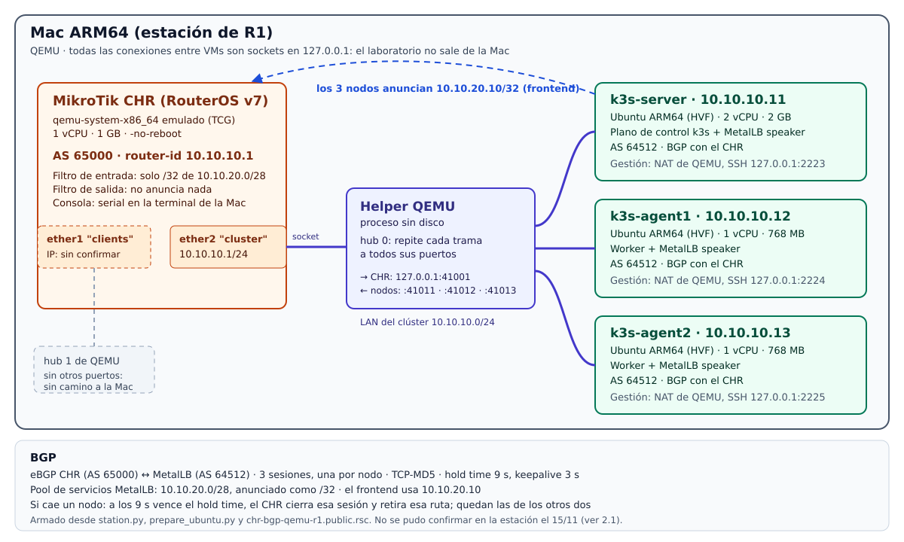

# Servicios en alta disponibilidad con k3s y BGP

**Universidad Tecnológica Nacional** — Facultad Regional La Plata

**Cátedra:** Gestión Operativa y Seguridad en Redes — **Trabajo Práctico N.º 4**, Proyecto Integrador

**Modalidad:** A — Desarrollo · **Grupo:** 4

**Integrantes:** Bellomo, Lorenzo · Ferrari, Agustín Nicolás · Guarino, Naim Hernan · Kloster, Agustín Ignacio · Siadore, Valentino

**Fecha de entrega:** 16/11/2026 · **Repositorio:** https://github.com/LoLoo03/goys-tp4-integrador

*Este informe condensa las secciones completas de `documento/secciones/`, donde está el detalle de cada configuración y de cada prueba, con sus salidas en `capturas/`.*

---

## 1. Resumen ejecutivo

Un servicio web corre en un clúster k3s de tres nodos y se publica por BGP hacia un router MikroTik CHR: cada nodo anuncia la IP del servicio (10.10.20.10/32) con MetalLB, y si un nodo se cae, el router deja de usarlo a más tardar a los 9 s —cuando vence el hold time; en la réplica lo detectó en 1 s— y el servicio sigue atendiendo desde los otros dos. El tráfico entre namespaces está segmentado con NetworkPolicies, todo el despliegue se hace con Ansible de forma idempotente, y Prometheus y Grafana muestran en vivo el estado de los nodos, las sesiones BGP y el consumo de recursos. El laboratorio completo corre en una sola computadora, sin internet.

El objetivo fue medir, no suponer, qué pasa cuando algo falla. Ante la caída abrupta de un nodo hay una ventana de 14 a 18 s con pedidos sueltos con error, sin corte total (12 de 674 pedidos en la medición del 15/11); la ventana la domina el tiempo en que Kubernetes da por muerto al nodo, no BGP, que retira la ruta en segundos. Con los valores por defecto de Kubernetes la ventana era de ~43 s (los parámetros ajustados están en la sección 5). Un rolling update y su rollback no pierden ningún pedido. Las pruebas de segmentación dan 8 de 8, la segunda corrida de Ansible da `changed=0` (medido en la réplica), y los backups del router y de la base de k3s se generan cifrados y verificados; la prueba de restauración del clúster se corre en la estación antes de la Feria.

La estación principal de la Feria es la Mac de R4 con la réplica con contenedores, donde el router es FRR en lugar del CHR, con la misma configuración lógica (sección 2.1); ahí se corrieron las pruebas de red. La réplica de la Feria usa nodos del perfil `normal` (server de 2 GiB), porque Grafana terminó necesitando 1 GiB; la meta original de que todo entrara en una laptop de 8 GB solo se midió en la primera corrida, con el perfil `chico` (sección 5). La Mac de 24 GiB con QEMU y el CHR real queda de respaldo: su prueba de diez minutos estimó un pico de 79,76 % de RAM, con aumento de swap.

## 2. Arquitectura de la solución

### 2.1. Diagrama de red



*Figura 1: Topología de la estación QEMU de R1, que en la Feria queda de respaldo.*

**Estaciones de la Feria.** La estación **principal** es la Mac de R4, con la réplica con contenedores (`demo/prueba-ram/`): los nodos son contenedores con k3s y MetalLB y el router es **FRR en lugar del MikroTik CHR**, con la misma configuración lógica (sección 3.1) y una red hacia los clientes (192.168.56.2/24) por donde entran los pedidos. La estación **de respaldo** es la Mac de R1, con QEMU y el CHR real, que es la que muestra el diagrama: el CHR (RouterOS v7, imagen x86_64 **emulada** con TCG, 1 vCPU y 1 GB), tres nodos Ubuntu ARM64 con k3s acelerados con HVF —cada uno con un *speaker* de MetalLB— y un proceso auxiliar de QEMU que une las placas en 10.10.10.0/24 como un *hub*. Todo son sockets en `127.0.0.1`: el laboratorio no sale de la Mac y funciona sin internet. Ahí la Mac no tendría camino de datos hacia el CHR; no se pudo confirmar, porque el 15/11 la estación no estaba funcionando.

Tabla 1: Direcciones y sistemas autónomos

| Equipo | Dirección en el clúster | ASN | Rol |
|---|---|---|---|
| CHR | 10.10.10.1/24 (ether2) | 65000 | Router de borde |
| k3s-server | 10.10.10.11 | 64512 | Plano de control y speaker MetalLB |
| k3s-agent1 | 10.10.10.12 | 64512 | Worker y speaker MetalLB |
| k3s-agent2 | 10.10.10.13 | 64512 | Worker y speaker MetalLB |
| Servicios (MetalLB) | 10.10.20.0/28; frontend en 10.10.20.10 | — | IPs anunciadas por BGP |

### 2.2. Componentes

Seis piezas arman el laboratorio: el **MikroTik CHR**, router virtual de borde, que establece las sesiones BGP y aprende la ruta a la IP del frontend; **K3s** (un nodo de control y dos agentes); **MetalLB**, que asigna la IP virtual al servicio `LoadBalancer` y la anuncia por BGP; **Prometheus** y **Grafana**, que recolectan y muestran las métricas de nodos, contenedores y MetalLB; y **Ansible**, que automatiza la preparación de los nodos, la instalación de K3s y el despliegue.

### 2.3. Flujo de datos

Un pedido de un cliente a `http://10.10.20.10/api/` recorre cinco saltos. (1) El cliente llega al CHR por su ruta hacia 10.10.20.0/28. (2) El CHR lo reenvía a uno de los tres nodos por la ruta 10.10.20.10/32 aprendida por eBGP: esa IP no pertenece a ninguna máquina, es la del Service `frontend`, que MetalLB anuncia desde los tres nodos. (3) En el nodo, kube-proxy lo lleva a una de las 3 réplicas del frontend —por la VXLAN de flannel si está en otro nodo—: con `externalTrafficPolicy: Cluster` cualquier nodo acepta y reparte. (4) nginx resuelve `backend.datos.svc` en CoreDNS y hace `proxy_pass` al ClusterIP. (5) kube-proxy elige una de las 2 réplicas del backend; la NetworkPolicy solo admite pods `app=frontend` de `web`. La respuesta vuelve por el mismo camino; como puede entrar por un nodo y atenderse en otro, kube-proxy aplica SNAT y el pod ve la IP del nodo de entrada, no la del cliente.

**Qué pasa durante la caída de un nodo.** Hay dos relojes: **BGP (9 s)** —hasta que vence el hold time, el CHR puede seguir mandando pedidos al nodo apagado— y **Kubernetes (~15–18 s)** —los demás nodos creen vivas las réplicas del caído y les siguen mandando pedidos hasta que queda `NotReady`—. La ventana termina cuando vence el más lento, el de Kubernetes: eso explica los 14 a 18 s con pedidos sueltos con error (sección 5), sin corte total. Si el nodo caído no tenía réplicas del frontend no hay errores: el 15/11 el router retiró la ruta al segundo y no falló ninguno de 732 pedidos.

**Actualización (rolling update).** Kubernetes crea una réplica nueva por vez (`maxSurge: 1`) y no baja ninguna hasta que la nueva pasa la readiness probe (`maxUnavailable: 0`); la vieja recibe `preStop: sleep 5` y sigue atendiendo mientras kube-proxy la saca del balanceo. Así ningún pedido llega a un pod que ya cerró.

## 3. Implementación

### 3.1. Configuración de red

El CHR (AS 65000) tiene una sesión eBGP con cada nodo (AS 64512): tres en total. MetalLB anuncia la IP del servicio como ruta /32 desde todos los nodos, así el CHR aprende la misma ruta por tres caminos. La configuración completa del router está en `demo/routeros/` y la de MetalLB en `demo/k8s/metallb/`; el resumen:

```yaml
# demo/k8s/metallb/bgp.yaml (resumen); el CHR usa hold-time=9s, keepalive-time=3s,
# entrada "solo /32 dentro de 10.10.20.0/28", salida "reject" y clave TCP-MD5
IPAddressPool:    addresses: [10.10.20.0/28]
BGPPeer:          myASN: 64512, peerASN: 65000, peerAddress: 10.10.10.1, holdTime: 9s
BGPAdvertisement: aggregationLength: 32
```

Decisiones y por qué:

- **Hold time de 9 s, keepalive de 3 s.** Con los valores por defecto (180/60 s), el router tardaría tres minutos en notar un nodo muerto; con 9 s la ruta se retira en hasta 9 s. Más bajo pide BFD, que detecta en menos de un segundo, pero BFD solo no alcanza: tiene que ir junto con `externalTrafficPolicy: Local` (sección 5). Además, MetalLB en modo nativo no soporta BFD; el modo FRR sí, pero suma ~100 MB por nodo y se descartó por el presupuesto de RAM.
- **Filtros de prefijos.** El CHR solo acepta del clúster rutas /32 dentro de 10.10.20.0/28 y no anuncia nada: si un nodo comprometido anunciara otra red, el router la descarta.
- **Autenticación TCP-MD5.** Cada sesión lleva una clave compartida que no está en el repositorio: el `.rsc` tiene un marcador y en el clúster la crea Ansible desde el vault cifrado.
- **Una sesión por nodo, sin route reflector.** Con tres nodos alcanza, y cada sesión cae sola cuando cae su nodo, que es lo que queremos mostrar.

**Lo que no pudimos comparar.** El `.rsc` público es una reconstrucción y el 15/11 la estación no estaba funcionando: **no está verificado contra el router real**. Sí revisamos el router de la réplica —la estación principal—: FRR 8.4 con la misma lógica (AS, timers, MD5, filtros), con una diferencia: por `maximum-paths 3` instala las **tres** rutas activas y reparte el tráfico; no sabemos si el CHR hace lo mismo o deja una sola.

### 3.2. Container networking

**Deployments y Services.** La aplicación (`demo/k8s/app/`) tiene dos capas, cada una en su namespace, para que las NetworkPolicies puedan separarlas: un Deployment `frontend` (nginx, 3 réplicas) en `web`, publicado por MetalLB como LoadBalancer con IP fija 10.10.20.10, y un Deployment `backend` (whoami, 2 réplicas) en `datos`, solo accesible por ClusterIP. Un namespace `otros`, sin servicios, hace de origen "de afuera" en las pruebas. Las imágenes son livianas y usan `imagePullPolicy: IfNotPresent`: la demo no necesita internet.

El Deployment del frontend concentra las decisiones de alta disponibilidad: 3 réplicas repartidas por nodo (`topologySpreadConstraints`), rolling update con `maxUnavailable: 0` y `maxSurge: 1`, readiness probe cada 2 s, `preStop: sleep 5` —sin esto el rolling update perdía 4 pedidos: nginx se apagaba antes de salir del balanceo— y un PDB con `minAvailable: 2` que frena a `kubectl drain`. El Service usa `externalTrafficPolicy: Cluster`: los tres nodos anuncian la IP aunque no tengan réplica (ver 2.3).

Para medir se usa `demo/scripts/medir-corte.sh`: un pedido HTTP cada 0,2 s con timeout de 1 s, informando las rachas de errores. Las operaciones que se demuestran son el rolling update (`set env APP_VERSION=v2`), el rollback (`rollout undo`) y el mantenimiento de un nodo (`drain` + `uncordon`).

Tabla 2: Resultados medidos en la réplica con contenedores (router FRR en lugar del CHR)

| Prueba | Primera medición | Medición del 15/11 |
|---|---|---|
| Rolling update a v2 | 0 pedidos perdidos | 0 de 294; el rollout tarda 3 s |
| Rollback a v1 | 0 pedidos perdidos | 0 de 293; ~2 s con v1 y v2 mezclados |
| `drain` con PDB | 0 pedidos perdidos | 0 de 436; el PDB frenó el segundo desalojo hasta que hubo reemplazo |
| Caída de un agent con una réplica del frontend | 10 de 384 con error en ~14 s | 12 de 674 con error en ~18 s |
| Caída de un agent sin réplicas del frontend | — | 0 de 732 |
| Caída de un agent (detección por defecto) | 31 de 475 con error en ~43 s | No se midió |

El 15/11 la estación QEMU no estaba funcionando y las pruebas se hicieron en la réplica, que después quedó como estación principal de la Feria; con el CHR real no están repetidas (sección 5). La salida completa está en `capturas/r3-pruebas-aplicacion.md`. En la réplica, la ventana de errores la marcó Kubernetes y no BGP (ver 2.3).

**Segmentación.** La red del clúster se divide en zonas, una por namespace, y cada zona arranca con la política de **denegar todo** (`demo/k8s/netpol/`): `web` solo admite ingreso TCP 80 a los pods del frontend; en `monitoring`, Grafana atiende en el 3000 y Prometheus solo acepta conexiones de Grafana. La zona más restringida es `datos`: su política de ingreso combina `namespaceSelector` y `podSelector` **en el mismo elemento**, así que el único que entra es el pod `app=frontend` del namespace `web`, por el puerto 80 —un pod cualquiera de `web` tampoco entra—, y su egreso permite únicamente DNS: si el backend se compromete, no puede abrir conexiones hacia otros pods ni hacia afuera. En una red plana, comprometer el servicio expuesto da acceso directo a los datos; acá el frontend es el único camino. **Límite:** `web` y `monitoring` solo restringen el ingreso (sección 5). La segmentación se complementa con los filtros y la autenticación BGP (3.1), los secretos en el vault (3.3), los backups cifrados (4.3) y el firewall del CHR, diseñado pero no cargado en la estación (4.2).

### 3.3. Automatización

Ansible corre en el server (conexión local) y llega a los agentes por SSH, según `demo/ansible/inventario.yml`. `site.yml` valida que no queden secretos de ejemplo, prepara el clúster en orden (roles `comun`, `k3s_server` y `k3s_agent`, esperando cada nodo `Ready`) y precarga las imágenes faltantes para el ensayo offline. `deploy.yml` aplica MetalLB y su BGP, la aplicación, el monitoreo y las NetworkPolicies, esperando la disponibilidad de cada pieza; `apply_checked.py` compara el estado antes y después para que Ansible registre solo cambios efectivos.

**Secretos.** Ansible Vault protege el token de K3s, la clave MD5 de BGP y la contraseña de Grafana. El repositorio incluye solo la plantilla `vault.example.yml`; los valores reales quedan en el Vault privado y las tareas que los aplican usan `no_log: true`.

### 3.4. Monitoreo

Prometheus y Grafana corren en el namespace `monitoring`, fijados al server con un `nodeSelector` por un motivo puntual de la demo: en la presentación se apaga un agent y el tablero tiene que seguir andando para mostrar la caída. Grafana se publica como NodePort en el 30300. Como la RAM es el recurso escaso, los límites son ajustados (Prometheus 384 MiB, node-exporter 32 MiB por nodo) y Prometheus retiene un día de datos. Grafana es la excepción: con 384 MiB y después con 512 MiB se quedó sin memoria al abrir el tablero (sección 4.2), así que su límite quedó en 1 GiB, y eso obligó a darle al server 2 GB de RAM. Prometheus raspa cada 10 s y evalúa reglas cada 5 s sobre tres orígenes: node-exporter en cada nodo (`up` alimenta la alerta de nodo caído), el cAdvisor de cada kubelet a través del proxy del API server (RAM y CPU por pod sin exponer el kubelet) y los speakers de MetalLB (`metallb_bgp_session_up`).

Tabla 3: Alertas configuradas

| Alerta | Condición | Espera | Qué significa |
|---|---|---|---|
| `NodoCaido` | `up{job="nodos"} == 0` | 15 s | Un nodo dejó de responder al raspado |
| `SesionBGPCaida` | `count(metallb_bgp_session_up{peer=~".*:179"} == 1) < 3` | 10 s | Quedan menos de 3 sesiones BGP establecidas |

La alerta de BGP cuenta sesiones establecidas en lugar de buscar sesiones en 0, por dos particularidades de MetalLB halladas al probar en la réplica (hallazgo de R4): cada speaker publica la métrica dos veces —la sesión real con `peer="...:179"` y una serie que queda siempre en 0— y, al morir un speaker, sus series desaparecen en lugar de pasar a 0. Mirar `== 0` disparaba la alerta con los tres nodos sanos y no la disparaba con un nodo caído; contar las sesiones reales cubre los dos casos. La réplica donde se probó es ahora la estación principal; queda confirmarla en la de respaldo, que usa los mismos manifiestos. Las esperas (15 y 10 s) hacen que las alertas se disparen durante la ventana de la caída y no por un raspado perdido.

El tablero muestra el estado en vivo (nodos, sesiones BGP, réplicas por nodo), la línea de tiempo de la caída y los recursos. Durante la caída, la sesión BGP cae primero y el contador de nodos pasa de 3 a 2; las réplicas del nodo caído no se recrean durante la demo (Kubernetes espera ~5 min de `tolerationSeconds`), pero a los ~18 s el clúster deja de mandarle pedidos.

*[Pendiente: Figura 2 — captura del tablero con `agent1` caído, tomada en la estación principal.]*

## 4. Verificación

### 4.1. Pruebas de conectividad

La consigna pedía validar la red en la estación QEMU, pero el 15/11 no estaba funcionando: las pruebas las corrió R4 en la réplica con contenedores —que después quedó como **estación principal de la Feria**—, traduciendo cada comando de RouterOS a su equivalente en FRR; R2 armó la lista de pruebas y revisó las salidas y las capturas (en `capturas/`, prefijo `r2-`). Los resultados corresponden, entonces, a la estación que se muestra en la Feria.

Tabla 4: Pruebas de conectividad en la estación principal (réplica, 15/11)

| Prueba | Resultado |
| --- | --- |
| Sesiones BGP (`show bgp summary`) | **3 sesiones establecidas**, cada una con 1 prefijo recibido |
| Ruta del servicio (`show ip route bgp`) | 10.10.20.10/32 por **los 3 nodos**, las 3 activas (ECMP) |
| Caída de agent1 (`docker kill`) | Sesión `Idle` **1 s** después (el kernel manda FIN); la ruta queda por .11 y .13 |
| Vuelta de agent1 | Sesión `Established` y ruta por los 3 nodos **4–5 s** después |
| Captura en el server (puerto 179) | 56 paquetes, **todos con TCP-MD5** |
| Captura en el router | 151 paquetes con MD5: keepalives de las 3 sesiones, **9 reintentos** con agent1 caído y, a la vuelta, 2 OPEN y 1 UPDATE |
| `traceroute` desde un cliente | Primer salto el router (192.168.56.2), segundo un nodo |

Las capturas se abren en Wireshark con el filtro `bgp` (o `tcp.option_kind == 19` para la firma MD5) y **no contienen la clave**: la opción MD5 lleva un resumen de cada segmento, no la clave; lo revisamos en los dos archivos.

**Qué no se pudo comprobar.** Los **9 s del hold time**: en la réplica, el kernel cierra la conexión TCP al matar el contenedor y el router se entera en 1 s; en la estación de respaldo la caída se detectaría recién al vencer el hold time —esperable, pero **no medido**—. Tampoco sabemos si el **CHR instala las tres rutas** como FRR o deja una sola, y los **cierres espontáneos del CHR** quedan como hipótesis sin confirmar; el detalle está en la sección 4.1 completa del repositorio.

### 4.2. Pruebas de segmentación

Las pruebas del 15/11 se corrieron en la réplica (k3s v1.36.6, FRR 8.4, dentro de una VM Ubuntu porque el kernel de Docker Desktop no soporta TCP MD5) **y también en la estación QEMU con el CHR real**, corridas por R1 con R4 validando (`capturas/r4-estacion-qemu.txt`). El script `demo/scripts/prueba-netpol.sh` crea pods de prueba en `otros`, `web` y `datos` e intenta conexiones HTTP y DNS, esperando 15 s a que las políticas estén programadas; antes de cada corrida se verificó que las 8 políticas estuvieran aplicadas y los 3 nodos `Ready`.

Tabla 5: Pruebas de segmentación

| # | Origen → destino | Esperado | Réplica, 15/11 | Estación QEMU, 15/11 |
|---|---|---|---|---|
| 1 | `otros` → frontend:80 (servicio público) | Permitido | Permitido | Permitido |
| 2 | `otros` → backend:80 | Bloqueado | Bloqueado | Bloqueado |
| 3 | Frontend → backend:80 | Permitido | Permitido | Permitido |
| 4 | Otro pod de `web` → backend:80 | Bloqueado | Bloqueado | Bloqueado |
| 5 | `datos` → frontend:80 (egreso) | Bloqueado | Bloqueado | Bloqueado |
| 6 | `datos` → kube-dns:53 (único egreso) | Permitido | Permitido | Permitido |
| 7 | `otros` → Prometheus:9090 | Bloqueado | Bloqueado | Bloqueado |
| 8 | `otros` → Grafana:3000 | Permitido | Permitido | Permitido |
| | **Total** | | **8 de 8**, en 22 s | **8 de 8** |

En la réplica el resultado se repitió en cuatro corridas. Las pruebas 3 y 4 son las más importantes: muestran que la política no habilita a un namespace entero sino a un pod concreto. Una corrida del ensayo dio 7 de 8 por un **falso negativo**: Grafana estaba reiniciándose por falta de memoria justo cuando corrió la prueba 8 —cuando el destino no responde, el script no distingue un bloqueo de un servicio caído—. Ese episodio llevó a medir la memoria de Grafana: con 384 MiB y con 512 MiB se quedó sin memoria al abrir el tablero —el 16/11, con 512 MiB, el OOM se repitió apenas abierto; con 1 GiB no se cayó—, así que el límite quedó en **1 GiB** (sección 3.4). Y subirlo sin arrastrar al resto del server pide un server de 2 GB: con 1280 MB, Grafana ocupó la RAM libre del nodo y cayó hasta la sesión BGP del server (`capturas/r4-grafana-memoria.txt`).

**BGP y filtros** (`capturas/r4-bgp-md5.txt`): autenticación activa en las 3 sesiones, 46 de 46 paquetes al puerto 179 con la opción TCP MD5, el router solo acepta `10.10.20.10/32` (1 ruta por nodo) y no anuncia nada (`PfxSnt = 0`). **Secretos fuera de git** (`capturas/r4-secretos.txt`): no hay claves privadas en los archivos versionados ni en el historial; solo está `vault.example.yml` con marcadores, y los archivos de secretos están ignorados por git.

**Firewall del CHR.** Solo se pudo revisar en la estación QEMU (FRR no tiene el firewall de RouterOS). **`chr-borde.rsc` no está cargado**: hay un firewall mínimo en `input` con la regla final de descarte **deshabilitada**; habilitada temporalmente, el SSH desde el server dio timeout y la regla contó 3 paquetes, confirmando que bloquea. Hoy el CHR acepta cualquier conexión desde el clúster; el grupo tiene que decidir si habilita la regla antes de la demo.

### 4.3. Pruebas de automatización

Se ejecutó `deploy.yml` cuatro veces en una réplica desechable ARM64, sin interfaz de red externa, con K3s `v1.36.6+k3s1` y Ansible Core `2.20.11`. La prueba no se realizó en la estación QEMU.

Tabla 6: Corridas de `deploy.yml`

| Ejecución | Condición de prueba | `changed` | Resultado |
|---|---|---:|---|
| 1 | Despliegue inicial | 8 | Aplicó el estado esperado |
| 2 | Repetición sin modificar el estado | 0 | No registró cambios |
| 3 | Se redujo deliberadamente de 2 a 1 el `minAvailable` del PDB | 1 | Restableció `minAvailable: 2` |
| 4 | Repetición después de corregir el desvío | 0 | No registró cambios |

Las cuatro ejecuciones terminaron con código 0, `failed=0` y `unreachable=0`. La secuencia **8 / 0 / 1 / 0** demuestra que el despliegue no vuelve a registrar cambios sobre el mismo estado y corrige el desvío introducido; el resultado se limita a `deploy.yml` en esa réplica y no demuestra la idempotencia de `site.yml` ni de la estación. Evidencia con recaps, versiones y hashes: `capturas/r1-idempotencia-replica.json`.

**Backups y restauración.** `backup.yml` guarda dos piezas en una carpeta del host, fuera de git, que sobrevive a la destrucción de las VMs: la exportación del CHR **sin la clave BGP** (el playbook se corta si la clave sigue presente) y un paquete con la base y el token de k3s, **cifrado** con la clave del vault, que se guarda fuera de la estación. Conserva los últimos cinco de cada uno, verifica cada backup al generarlo y en el CHR usa un usuario `backup` de solo lectura. La restauración tiene una prueba definida —backup, borrar el Deployment del frontend, `restore.yml`, y el servicio tiene que volver—, que se corre en la estación principal antes de la Feria; hasta entonces, lo verificado son las restauraciones de monitoreo en réplicas aisladas (`capturas/r1-evidencias-estacion.md`). Para el CHR no se restaura desde la exportación: la fuente de verdad es el archivo versionado en git, y la exportación sirve para detectar desvíos. Las VMs y las imágenes se reconstruyen desde el repositorio.

*[Pendiente: salida de `backup.yml` y de la prueba de restauración corridas en la estación.]*

## 5. Limitaciones y trabajo futuro

Tabla 7: Limitaciones conocidas

| Limitación | Consecuencia | Cómo se resolvería |
|---|---|---|
| **Un solo server de k3s** | Si cae el server, los pods siguen atendiendo pero no se puede administrar el clúster | Tres servers con etcd. Quedó afuera por RAM (~1,1 GiB el server) |
| **14–18 s de pedidos sueltos con error al caer un nodo** | Falla una parte de los pedidos (12 de 674 el 15/11), solo si el nodo tenía réplica del frontend. Por defecto eran ~43 s | **BFD + `externalTrafficPolicy: Local`**: BFD solo no alcanza (sección 6); pide el modo FRR de MetalLB, más RAM de la que había |
| **Pruebas de HA y de red sin repetir con el CHR real** | Se midió en la réplica, hoy estación principal; el CHR real (respaldo) sigue sin verificar | Repetir las pruebas en la estación de respaldo si se la usa |
| **Las estaciones son Macs, no la laptop de 8 GB del planteo** | La demo va en la Mac de R4 con la réplica (FRR), con nodos del perfil `normal` (server 2 GiB, agents 1 GiB): con el `chico`, el server no entra con margen (sección 4.2). La de 24 GiB con QEMU y CHR queda de respaldo (pico estimado 79,76 % de RAM, con swap) | Medir el perfil `chico` en una laptop de 8 GB, o asumir el `normal`, que pide 16 GB |
| Bajar los tiempos de detección tiene costo | Un `node-monitor-grace-period` corto puede dar por caído un nodo que solo estaba lento | En producción: valores por defecto de Kubernetes junto con BFD y `Local` |
| SNAT por `externalTrafficPolicy: Cluster` | El backend no ve la IP real del cliente | `Local` evita el SNAT, pero solo anuncian los nodos con réplica |

A esto se suman los límites de seguridad de 3.2 y 4.2: el firewall completo del CHR está diseñado pero no cargado y su regla de descarte está deshabilitada; `web` y `monitoring` no restringen el egreso; la autenticación BGP usa TCP MD5 —lo que soportan MetalLB y RouterOS—, cuyo reemplazo moderno es TCP-AO (RFC 5925); y no hay mTLS entre frontend y backend. **Trabajo futuro:** un Ingress con TLS delante del frontend, una base de datos con réplicas en el backend y probar la restauración completa de la estación desde el respaldo.

## 6. Conclusiones

La lección más grande del proyecto es que medir le gana a suponer. La hipótesis inicial era que para no perder pedidos ante la caída de un nodo alcanzaba con BFD, que detecta la caída en menos de un segundo. La medición mostró otra cosa: el router retiró la ruta al segundo y los errores siguieron, porque los propios nodos sanos reparten pedidos hacia la réplica muerta hasta que Kubernetes la da por caída. Hay dos relojes corriendo a la vez —el de la red y el de Kubernetes— y la ventana de error la cierra el más lento. Entender eso cambió la respuesta: no es una herramienta, es la combinación de BFD con `externalTrafficPolicy: Local`. A ese entendimiento se llegó midiendo: de ~43 s con los valores por defecto a 14–18 s con los parámetros ajustados.

Lo más difícil fue el presupuesto de RAM: cada decisión técnica —un solo server, sin BFD, límites ajustados en el monitoreo, perfiles de memoria por laptop— salió de que todo tenía que correr en una sola computadora. La estación cambió de VirtualBox a QEMU en el camino, y la réplica con contenedores, que nació para probar en equipos chicos, terminó siendo la estación principal de la Feria, con la QEMU y el CHR real como respaldo. Trabajar sin internet hizo pensar por adelantado qué imágenes, paquetes y claves tenían que estar antes.

El trabajo se repartió por capas, una por integrante: estación y automatización (R1), red y BGP (R2), aplicación y alta disponibilidad (R3), segmentación y secretos (R4), y monitoreo, backups y este documento (R5). Todo entró por pull requests revisados por otro integrante, con la regla de que al repositorio no entran claves ni rutas personales; esa revisión cruzada atajó errores y obligó a que cada parte quedara reproducible desde el repositorio.

## 7. Referencias

- IETF. (2006). *RFC 4271: A Border Gateway Protocol 4 (BGP-4)*. Recuperado de https://datatracker.ietf.org/doc/rfc4271/
- IETF. (1998). *RFC 2385: Protection of BGP Sessions via the TCP MD5 Signature Option*. Recuperado de https://datatracker.ietf.org/doc/rfc2385/
- IETF. (2010). *RFC 5880: Bidirectional Forwarding Detection (BFD)*. Recuperado de https://datatracker.ietf.org/doc/rfc5880/
- IETF. (2010). *RFC 5925: The TCP Authentication Option*. Recuperado de https://datatracker.ietf.org/doc/rfc5925/
- The Kubernetes Authors. (s.f.). *Kubernetes Documentation: Deployments, Services y Network Policies*. Recuperado de https://kubernetes.io/docs/
- K3s Project, SUSE. (s.f.). *K3s: Lightweight Kubernetes — Documentation*. Recuperado de https://docs.k3s.io/
- MetalLB Project. (s.f.). *MetalLB Documentation: BGP mode*. Recuperado de https://metallb.io/
- Prometheus Authors. (s.f.). *Prometheus Documentation: Alerting rules*. Recuperado de https://prometheus.io/docs/
- Grafana Labs. (s.f.). *Grafana Documentation: Dashboards*. Recuperado de https://grafana.com/docs/
- MikroTik. (s.f.). *RouterOS Documentation: BGP*. Recuperado de https://help.mikrotik.com/docs/
- Red Hat. (s.f.). *Ansible Documentation: Playbooks y Ansible Vault*. Recuperado de https://docs.ansible.com/
- QEMU Project. (s.f.). *QEMU Documentation*. Recuperado de https://www.qemu.org/docs/master/
