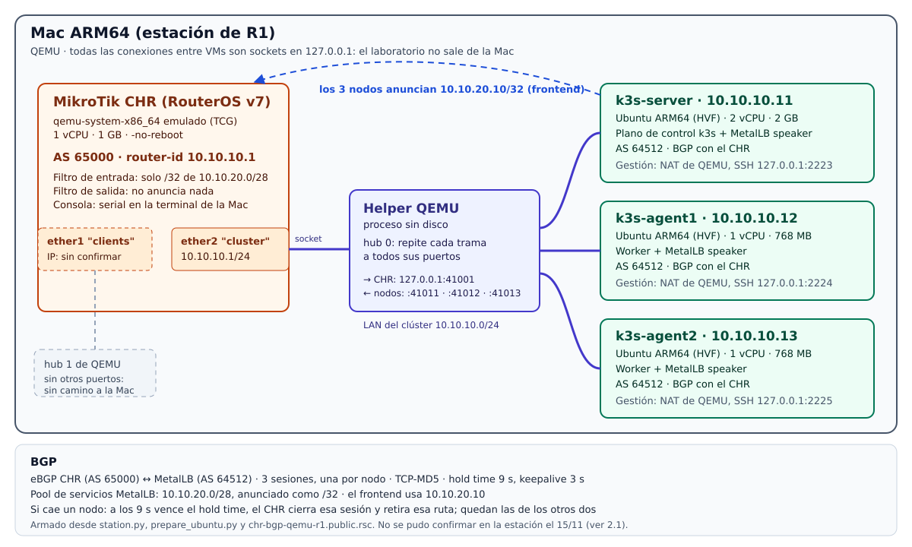

### 2.1. Diagrama de red

*Figura 1: Topología de la estación de la Feria, tal como está armada en QEMU.*

El laboratorio corre entero dentro de una Mac ARM64, con QEMU. Tiene cinco procesos:

- **Un router MikroTik CHR** (RouterOS v7). Como es una imagen x86_64, en la Mac
  corre **emulado** (TCG), con 1 vCPU y 1 GB. Es el router de borde: habla BGP con
  el clúster y aprende por dónde llegar a los servicios.
- **Tres nodos Ubuntu ARM64** con k3s, que corren con aceleración (HVF): un server
  (10.10.10.11) y dos agents (10.10.10.12 y 10.10.10.13). En cada uno corre un
  *speaker* de MetalLB, que es el que anuncia las IPs de los servicios.
- **Un proceso auxiliar de QEMU, sin disco**, que hace de switch: une la placa
  `cluster` del CHR con las de los tres nodos en la red 10.10.10.0/24. Es un *hub*:
  repite cada trama a todos sus puertos.

Todas las conexiones entre procesos son sockets en `127.0.0.1`, así que el
laboratorio no sale de la Mac y funciona sin internet. Cada nodo tiene además una
placa de gestión (NAT de QEMU) con SSH en `127.0.0.1:2223`, `:2224` y `:2225`.

*Tabla 1: Direcciones y sistemas autónomos*

| Equipo | Dirección en el clúster | ASN | Rol |
|---|---|---|---|
| CHR | 10.10.10.1/24 (ether2) | 65000 | Router de borde |
| k3s-server | 10.10.10.11 | 64512 | Plano de control y speaker MetalLB |
| k3s-agent1 | 10.10.10.12 | 64512 | Worker y speaker MetalLB |
| k3s-agent2 | 10.10.10.13 | 64512 | Worker y speaker MetalLB |
| Servicios (MetalLB) | 10.10.20.0/28; frontend en 10.10.20.10 | — | IPs anunciadas por BGP |

**Diferencia con el diseño original.** El diseño con VirtualBox tenía una red
*host-only* (192.168.56.0/24) entre la laptop y la placa `clients` del CHR (ether1),
para que la laptop hiciera de cliente. En la estación QEMU esa placa está conectada a
un hub sin otros puertos, así que la Mac no tiene camino de datos hacia el CHR. No lo
pudimos confirmar en la estación ni ver qué IP tiene ether1, porque el 15/11 la
estación no estaba funcionando. Las pruebas de la sección 4.1 se hicieron en la
réplica con contenedores, donde el router sí tiene una red hacia los clientes
(192.168.56.2/24), como en el diseño con VirtualBox.
