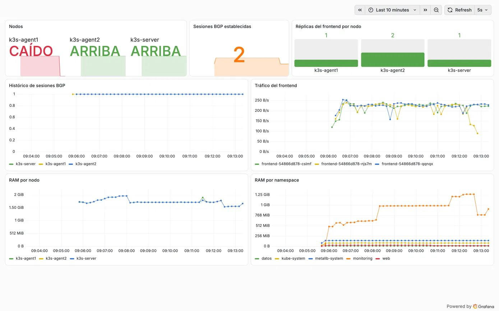

### 3.4. Monitoreo

Prometheus y Grafana corren en el namespace `monitoring`. Los dos están fijados al server con un `nodeSelector` por un motivo puntual de la demo: en la presentación se apaga un agent, y el tablero tiene que seguir andando para mostrar la caída. Grafana se publica como NodePort en el puerto 30300 (http://10.10.10.11:30300). Como la RAM es el recurso escaso del laboratorio, los componentes tienen límites ajustados (Prometheus 384 MiB, node-exporter 32 MiB por nodo) y Prometheus retiene solo un día de datos. Grafana es la excepción: con 384 MiB y después con 512 MiB se quedó sin memoria al abrir el tablero (sección 4.2 y `capturas/r4-grafana-memoria.txt`), así que su límite quedó en 1 GiB. Eso obligó a darle al server 2 GB de RAM: con 1280 MB, Grafana ocupaba la memoria libre del nodo y el resto del server empezaba a fallar.

Prometheus raspa cada 10 s y evalúa las reglas cada 5 s, sobre tres orígenes:

Tabla 7: Orígenes de métricas

| Job | Qué raspa | Para qué |
|---|---|---|
| `nodos` | node-exporter (DaemonSet, puerto 9100) en cada nodo | CPU, RAM y red de las VMs; la métrica `up` alimenta la alerta de nodo caído |
| `contenedores` | cAdvisor de cada kubelet, pasando por el proxy del API server | RAM y CPU por pod y namespace, sin abrir el puerto del kubelet a la red de pods; se conservan solo las tres métricas que usa el tablero |
| `metallb` | Los speakers y el controller de MetalLB | `metallb_bgp_session_up`: el estado de la sesión BGP de cada nodo con el CHR |

Las dos alertas están pensadas para la misma historia que cuenta la demo:

Tabla 8: Alertas configuradas

| Alerta | Condición | Espera | Qué significa |
|---|---|---|---|
| `NodoCaido` | `up{job="nodos"} == 0` | 15 s | Un nodo dejó de responder al raspado |
| `SesionBGPCaida` | `(count(metallb_bgp_session_up{peer=~".*:179"} == 1) or vector(0)) < 3` | 10 s | Quedan menos de 3 sesiones BGP establecidas con el CHR |

La alerta de BGP cuenta sesiones establecidas en lugar de buscar sesiones en 0, por dos particularidades de MetalLB que aparecieron al probar en la réplica (hallazgo de R4): cada speaker publica `metallb_bgp_session_up` dos veces —con `peer="10.10.10.1:179"`, la sesión real, y con `peer="10.10.10.1"`, una serie que queda siempre en 0—, y cuando un speaker muere sus series desaparecen en lugar de pasar a 0. Mirar `== 0` disparaba la alerta con los tres nodos sanos y no la disparaba con un nodo caído; contar las sesiones reales (`:179`) cubre los dos casos, incluido el speaker muerto. La réplica donde se probó es ahora la estación principal de la Feria; queda confirmarla en la estación QEMU de respaldo, que usa los mismos manifiestos. Las esperas (15 s y 10 s) están elegidas para que en la demo las alertas se disparen durante la ventana de la caída y no antes, evitando falsos positivos por un raspado perdido.

El tablero de Grafana ("TP4 — Servicios en alta disponibilidad") tiene tres grupos de paneles: el estado en vivo (cantidad de nodos, sesiones BGP establecidas y réplicas del frontend por nodo), la línea de tiempo de la caída (histórico de sesiones BGP) y los recursos (RAM por nodo, RAM por namespace y tráfico del frontend). Durante la caída de un nodo se ve la secuencia: la sesión BGP cae primero y el contador de nodos pasa de 3 a 2. Las réplicas del nodo caído no se recrean en los nodos vivos durante la demo —Kubernetes espera ~5 min (`tolerationSeconds`) antes de reprogramarlas—, así que el panel de réplicas muestra 2 de 3 hasta que el nodo vuelve; lo que sí pasa a los ~18 s es que el clúster deja de mandarle pedidos.

*Figura N: Tablero con `agent1` caído, en la estación principal: quedan 2 de 3 sesiones BGP y, pasados los ~5 min de tolerancia, su réplica ya se recreó en agent2.*
