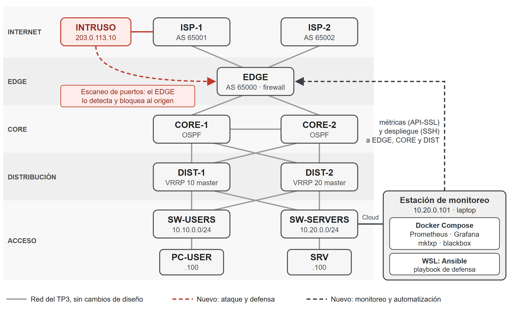

# Sistema Inmune: la red que se cura y se defiende sola

*Failover automático y bloqueo de intrusiones sobre una red empresarial MikroTik, con Ansible y Prometheus/Grafana*

**Propuesta de proyecto — TP4 Integrador · Feria de Redes 2026**
Gestión Operativa y Seguridad en Redes (GOYS) · UTN Facultad Regional La Plata

| | |
|---|---|
| **Grupo** | 11 · Ingeniería en Sistemas de Información |
| **Integrantes** | Lautaro Aubert · Juan Bautista Cuenca · Tomás Martin · Santiago Natalichio Bestosini |
| **Modalidad** | A — Proyecto de Desarrollo |
| **Base** | Red del TP3 «Laboratorio Failover Routing: la red que no se cae» ([LauAubert/goys-failover-grupo11](https://github.com/LauAubert/goys-failover-grupo11)) |
| **Estado** | Propuesta. Todavía no hay nada implementado en este repositorio. |

> **En una línea:** la red del TP3 ya se recupera sola de una falla; queremos que además **avise** cuando algo pasa y **se defienda** cuando alguien la ataca.

## Resumen

En el TP3 armamos una red empresarial redundante con siete routers MikroTik CHR. La red se recupera sola cuando falla un gateway, un enlace o un proveedor, pero tiene dos puntos ciegos: nadie se entera de una falla mientras pasa, y el firewall no distingue a un atacante del resto del tráfico. Proponemos sumarle un tablero de monitoreo en tiempo real (Prometheus y Grafana en Docker), una defensa en el router de borde que detecta escaneos de puertos y bloquea al origen por su cuenta, y un playbook de Ansible que despliega esa defensa.

El trabajo cubre las tres áreas de la materia. Lo evaluamos con dos mediciones que salen del tablero: **cuánto tarda la red en recuperarse de una falla** y **cuánto tarda en neutralizar un ataque**.

**Palabras clave:** alta disponibilidad, monitoreo, detección de escaneos, MikroTik, Prometheus, Ansible.

---

## 1. El problema

En el TP3 armamos una red empresarial redundante con siete routers MikroTik CHR en GNS3: dos proveedores con eBGP, OSPF área 0 entre borde, núcleo y distribución, y VRRP con un master distinto para cada LAN. Comprobamos que, si cae un gateway, un enlace o un proveedor, la red se recupera en segundos sin que nadie toque nada.

Ese mismo trabajo dejó a la vista dos puntos ciegos:

1. **Nadie se entera de una falla mientras ocurre.** El monitoreo se limitaba a eventos en el log de un router. Un reinicio inesperado de CORE-2 recién se notó horas después.
2. **El firewall no distingue a un atacante.** El EDGE aplica una política fija: descarta lo que no está permitido, pero no reacciona ante alguien que está tanteando la red desde Internet.

## 2. Objetivos

**General.** Que la red, además de recuperarse, avise y se defienda.

**Específicos.**

- **(a) Observar:** ver en tiempo real el estado de la red y medir cuánto tarda en recuperarse de una falla.
- **(b) Defender:** detectar un escaneo de puertos en el router de borde y bloquear al origen sin intervención humana.
- **(c) Automatizar:** aplicar esa defensa con un solo comando, de forma repetible.

### La idea que ordena el diseño

Pensamos la red como un organismo. El TP3 le dio la capacidad de cicatrizar y una piel; este proyecto le agrega el sistema nervioso y las defensas.

| Organismo | En la red | Origen |
|---|---|---|
| Cicatrización | VRRP, OSPF y eBGP reconvergen ante una falla | TP3 |
| Piel | Hardening, autenticación en el plano de control, firewall | TP3 |
| Sistema nervioso | Prometheus, Grafana y alertas | **TP4** |
| Glóbulos blancos | Detección de escaneos en el EDGE | **TP4** |
| Anticuerpos | Bloqueo del origen, desplegado con Ansible | **TP4** |

---

## 3. Diseño

### 3.1 Topología

La topología jerárquica del TP3 se mantiene **sin cambios de diseño**. Sobre ella sumamos tres piezas:

- **INTRUSO:** un equipo Linux del lado de ISP-1 que hace de atacante en Internet.
- **Defensa en el EDGE:** dos reglas nuevas en su firewall (detección y bloqueo).
- **Estación de monitoreo:** la laptop del grupo, conectada a SW-SERVERS mediante un nodo *Cloud* de GNS3. Va en la LAN SERVERS porque el TP3 ya habilita la gestión de los routers desde esa red.



*Gris: red del TP3, sin cambios. Rojo: atacante y defensa en el EDGE. Punteado oscuro: la estación lee métricas (API-SSL) y despliega la defensa (SSH).*

```
  INTERNET      INTRUSO 203.0.113.10 ---- ISP-1 (AS 65001)        ISP-2 (AS 65002)
                                              \                     /
                                               \  eBGP + TCP-MD5   /
  BORDE                                       EDGE (AS 65000) <-- detector + bloqueo
                                               /                   \
  NÚCLEO                                  CORE-1 ---------------- CORE-2     OSPF área 0 (MD5)
                                            |    \              /    |
                                            |     \------------/     |
  DISTRIBUCIÓN                            DIST-1                   DIST-2    VRRP autenticado
                                            |    \              /    |
                                            |     \------------/     |
  ACCESO                               SW-USERS                SW-SERVERS ==Cloud== ESTACIÓN 10.20.0.101
                                       10.10.0.0/24            10.20.0.0/24         (Docker + Ansible)
                                            |                        |
                                       PC-USER .100              SRV .100
```

### 3.2 Direccionamiento relevante

| Equipo | Dirección | Para qué importa |
|---|---|---|
| EDGE | `203.0.113.2` (hacia ISP-1) | Destino del escaneo |
| ISP-1 / ISP-2 | `203.0.113.1` / `203.0.113.5` | Vecinos BGP: nunca deben quedar bloqueados |
| Routers de la empresa | `10.255.255.1` a `.5` (loopbacks) | Lo que consulta el monitoreo |
| PC-USER / SRV | `10.10.0.100` / `10.20.0.100` | Hosts de cada LAN |
| Estación de monitoreo | `10.20.0.101` | LAN SERVERS (gestión) |
| INTRUSO | `203.0.113.10` | Red `203.0.113.8/30`, anunciada por ISP-1 |

### 3.3 Cómo se comporta la red

**Ante una falla** (heredado del TP3). Si cae el master VRRP de una LAN, el otro router de distribución toma la IP virtual. Si se corta un enlace interno, OSPF recalcula por el CORE restante o por el enlace CORE-1–CORE-2. Si se cae un proveedor, el EDGE sale por el otro.

**Ante un ataque** (nuevo). El INTRUSO lanza un escaneo con `nmap` contra la IP pública del EDGE. El detector de escaneos de RouterOS (*port scan detection*, `psd`) pondera cada intento de conexión según el puerto. Cuando un mismo origen supera el umbral, su IP entra en la lista `bloqueados` durante dos minutos, y una regla en la tabla `raw` descarta todo su tráfico **antes** del seguimiento de conexiones, para que el ataque no consuma recursos del router. Los proveedores están en una lista de confianza que queda fuera de la detección.

Boceto de las reglas (los valores se ajustan en las pruebas):

```routeros
/ip firewall address-list
add list=confianza address=203.0.113.1 comment="ISP-1"
add list=confianza address=203.0.113.5 comment="ISP-2"

/ip firewall filter
add chain=input protocol=tcp psd=21,3s,3,1 src-address-list=!confianza \
    action=add-src-to-address-list address-list=bloqueados \
    address-list-timeout=2m comment="defensa: detecta escaneo"

/ip firewall raw
add chain=prerouting src-address-list=bloqueados action=drop \
    comment="defensa: descarta al origen bloqueado"
```

**Mientras tanto** (nuevo). La estación consulta a los cinco routers de la empresa cada 5 segundos y hace un ping por segundo hacia los proveedores. Las métricas de los routers muestran **lo que pasa adentro** (interfaces, sesiones BGP, contadores del firewall); el ping muestra **lo que nota un usuario**. Esta combinación de monitoreo interno y de caja negra es la que recomienda la práctica de SRE.

---

## 4. Cobertura de las tres áreas

| Área | Qué aporta el proyecto | Base que reutilizamos |
|---|---|---|
| **Redes** | Topología jerárquica de 7 routers con eBGP, OSPF y VRRP; red del atacante anunciada por ISP-1; estación integrada a GNS3 | TP3 completo |
| **Operación** | Prometheus + Grafana en Docker Compose, cuatro alertas, medición de tiempos de recuperación, playbooks de Ansible idempotentes, runbooks de la demo | Runbooks y drills del TP3 |
| **Seguridad** | Detección de escaneos y bloqueo automático en el borde, acceso de monitoreo de solo lectura, secretos fuera de Git | Firewall, hardening y autenticación del TP3 |

---

## 5. Herramientas

El criterio fue reutilizar el laboratorio del TP3 y sumar solo piezas que se puedan levantar en una laptop, sin Internet, y explicar en pocos minutos frente a un visitante.

| Área | Necesidad | Elegimos | Alternativa evaluada y por qué no |
|---|---|---|---|
| Redes | Simular la empresa | GNS3 + MikroTik CHR | Una topología nueva: perderíamos lo ya probado en el TP3 |
| Operación | Leer estado y contadores del firewall | `mktxp` (exporter para RouterOS) | SNMP del TP3: no expone los contadores del firewall |
| Operación | Medir lo que nota el usuario | `blackbox_exporter` (ICMP) | Netwatch de RouterOS: solo deja una línea en el log |
| Operación | Guardar métricas y alertar | Prometheus | Zabbix: más pesado para este alcance |
| Operación | Mostrar el estado en vivo | Grafana | Ninguna |
| Operación | Levantar el stack | Docker Compose | K3s: excesivo para cuatro servicios |
| Operación | Aplicar la defensa | Ansible (colección `community.routeros`), desde WSL | Comandos a mano: no repetibles |
| Seguridad | Detectar el escaneo | `psd` del firewall de RouterOS | Suricata o CrowdSec: más piezas que tienen que funcionar en cadena |
| Seguridad | Bloquear al origen | *Address-list* + tabla `raw` | Event-Driven Ansible: suma latencia y un punto de falla |
| Seguridad | Simular al atacante | Linux + `nmap` | Container dentro de GNS3: exige la GNS3 VM |

---

## 6. Seguridad

Conservamos todas las defensas del TP3 y agregamos las de este proyecto. Cada medida responde a una amenaza concreta y deja una evidencia que se puede mostrar en la feria.

| Amenaza | Defensa | Evidencia esperada | Origen |
|---|---|---|---|
| Acceso desde Internet a las LAN | Firewall del EDGE con descarte por defecto | Ping desde ISP-1 a una LAN sin respuesta | TP3 |
| Router falso en OSPF o BGP | MD5 en OSPF, TCP-MD5 en BGP, VRRP autenticado | Con clave incorrecta no hay adyacencia ni sesión | TP3 |
| Intento de administrar un router | SSH y Winbox solo desde gestión | SSH desde un proveedor: ni siquiera pide contraseña | TP3 |
| Abuso del acceso de monitoreo | API-SSL habilitada solo desde `10.20.0.101`, con usuario de solo lectura | Conexión a la API desde otra IP: rechazada | **TP4** |
| Reconocimiento por escaneo | Detector `psd` + bloqueo de 2 minutos | El origen aparece en `bloqueados` y su ping deja de responder | **TP4** |
| Bloquear a un proveedor por error | Lista `confianza` excluida de la detección | Las sesiones BGP siguen establecidas durante el ataque | **TP4** |
| Filtración de credenciales | Ansible Vault y archivo `.env` fuera de Git | El repositorio no contiene secretos | **TP4** |

---

## 7. Operación

### 7.1 Tablero y alertas

El tablero de Grafana tiene cuatro paneles:

1. **Ping de punta a punta** hacia los proveedores (lo que ve el usuario).
2. **Estado de los enlaces** de los cinco routers.
3. **Sesiones BGP** del EDGE con cada proveedor.
4. **Tráfico descartado por la defensa** e IPs en `bloqueados`.

Prometheus evalúa cuatro alertas: **destino inalcanzable**, **enlace caído**, **sesión BGP caída** e **intruso bloqueado**.

El ping se muestrea **cada segundo**, no cada 15 s como Prometheus por defecto: en el TP3 las fallas más cortas duraron entre 2 y 4 segundos, y con el intervalo por defecto pasarían inadvertidas.

### 7.2 Automatización

| Playbook | Qué hace |
|---|---|
| `defensa.yml` | Verifica qué reglas ya existen en el EDGE y agrega solo las que faltan. Se puede correr varias veces con el mismo resultado (idempotente). |
| `defensa-quitar.yml` | Deja el EDGE exactamente como estaba antes de la defensa. |

Se acompañan de dos runbooks: uno para preparar la estación desde cero y otro para reiniciar la demo entre visitantes.

### 7.3 Lo que vamos a medir

El documento final se apoya en dos números, ambos leídos del tablero:

| Medición | Desde | Hasta |
|---|---|---|
| **Tiempo de recuperación** | Primer ping perdido tras provocar la falla | Primer ping respondido después |
| **Tiempo de neutralización** | Inicio del escaneo con `nmap` | El origen aparece en `bloqueados` y sus paquetes empiezan a descartarse |

---

## 8. Plan de trabajo

| Hito | Entregable verificable | Responsable |
|---|---|---|
| **H1** Laboratorio | Copia del proyecto GNS3; el del TP3 queda intacto | Santiago |
| **H2** Conectividad | Ping desde un container de la estación hasta el EDGE | Santiago |
| **H3** Tablero | Paneles de los cinco routers y alertas funcionando | Juan Bautista |
| **H4** Atacante | INTRUSO escaneando el EDGE a través de ISP-1 | Tomás |
| **H5** Defensa | Reglas de detección y bloqueo probadas a mano | Santiago y Tomás |
| **H6** Automatización | `defensa.yml` idempotente y `defensa-quitar.yml` | Lautaro |
| **H7** Ensayo | Tres corridas completas de la demo y video de respaldo | Todo el grupo |

### Organización prevista del repositorio

```
demo/
├── docker-compose.yml       # Prometheus, Grafana, mktxp, blackbox_exporter
├── prometheus/              # scrape config y reglas de alerta
├── grafana/                 # datasource y tablero provisionados
├── mktxp/                   # config del exporter (credenciales en .env, fuera de Git)
├── ansible/                 # inventario, defensa.yml, defensa-quitar.yml, vault
└── runbooks/                # preparar la estación y reiniciar la demo
diagramas/                   # topología propuesta y final
capturas/                    # evidencia de cada prueba
documento/  poster/          # entregables finales
```

---

## 9. La demo en la feria

La estación muestra GNS3 y el tablero de Grafana lado a lado. El recorrido dura unos cuatro minutos:

1. **Falla.** El visitante apaga un router o corta un enlace; en el tablero se ven el corte y la recuperación.
2. **Ataque sin defensa.** Lanza el escaneo desde el INTRUSO: `nmap` lista lo que encuentra.
3. **Despliegue.** Corremos `defensa.yml` frente a él.
4. **Ataque con defensa.** Repite el escaneo: queda bloqueado en segundos, el panel de defensa lo registra y las sesiones BGP siguen arriba.

Entre visitantes se corre `defensa-quitar.yml` y la red vuelve al punto de partida.

---

## 10. Alcance y riesgos

**Fuera de alcance.** K3s, un IDS con firmas y la respuesta disparada por eventos: los tres suman componentes que tendrían que funcionar en cadena durante la demo. Además, el detector de RouterOS identifica escaneos rápidos, pero **no** ataques lentos ni de fuerza bruta; para eso haría falta un IDS.

| Riesgo | Plan B |
|---|---|
| Docker no llega a la red de GNS3 | Prometheus y Grafana nativos en Windows |
| Falta memoria (8 nodos + 4 containers) | Laptop de 16 GB y snapshot previo del laboratorio |
| Corte silencioso de BGP (hasta 160 s en detectarse) | Demostrar con cortes que bajan la interfaz; BFD como trabajo futuro |
| Algo falla en vivo | Video de cada prueba y capturas en el repositorio |

---

## 11. Resultado esperado

Llegar a la feria con la red del TP3 funcionando junto a un tablero que muestra cada falla y cada recuperación, y con una defensa que corta un escaneo en segundos sin afectar el routing. Los dos tiempos medidos, **recuperación** y **neutralización**, serán el resultado central del documento final.

---

## Referencias

1. Grupo 11, «Laboratorio Failover Routing: la red que no se cae», memoria del TP3, GOYS, UTN FR La Plata, 2026. <https://github.com/LauAubert/goys-failover-grupo11>
2. Y. Rekhter, T. Li y S. Hares, *A Border Gateway Protocol 4 (BGP-4)*, RFC 4271, IETF, 2006.
3. J. Moy, *OSPF Version 2*, RFC 2328, IETF, 1998.
4. S. Nadas, *Virtual Router Redundancy Protocol (VRRP) Version 3 for IPv4 and IPv6*, RFC 5798, IETF, 2010.
5. G. F. Lyon, *Nmap Network Scanning*, Insecure.Com LLC, 2009.
6. MikroTik, *RouterOS Documentation: Firewall*. <https://help.mikrotik.com/docs/>
7. B. Beyer, C. Jones, J. Petoff y N. R. Murphy, *Site Reliability Engineering*, O'Reilly Media, 2016.
8. A. Kuznetsov, *mktxp: Prometheus exporter for Mikrotik RouterOS devices*. <https://github.com/akpw/mktxp>
9. Prometheus Authors, *Prometheus Documentation*. <https://prometheus.io/docs/>
10. Grafana Labs, *Grafana Documentation*. <https://grafana.com/docs/grafana/latest/>
11. Red Hat, *Ansible: community.routeros collection*. <https://docs.ansible.com/ansible/latest/collections/community/routeros/>
12. A. Heffernan, *Protection of BGP Sessions via the TCP MD5 Signature Option*, RFC 2385, IETF, 1998.
13. K. Scarfone y P. Mell, *Guide to Intrusion Detection and Prevention Systems (IDPS)*, NIST SP 800-94, 2007.
14. D. Katz y D. Ward, *Bidirectional Forwarding Detection (BFD)*, RFC 5880, IETF, 2010.
